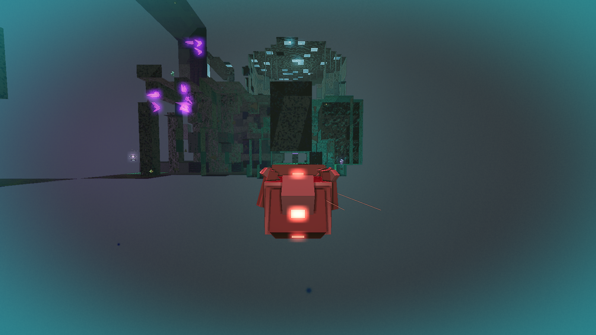
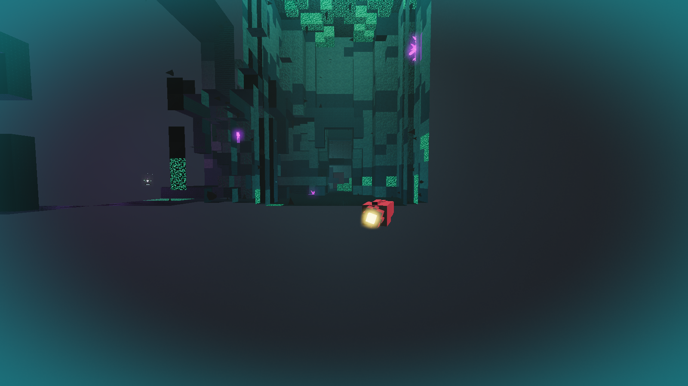

# Enemy Threats & Behaviors

This document lists the hostile life forms native to the void sectors.

---

## 1. Void Stalker

- **Threat Level**: Medium-High (High in unlit areas).
- **Spawn Conditions**: Ambient caves, dark corners, low illumination, triggered by mining drill acoustic vibrations.
- **Model Anatomy & PBR Shading**:
  - Deep void obsidian carapace (`RGB(0.04, 0.04, 0.05)`, Roughness 0.25, Metallic 0.40).
  - Bioluminescent compound ruby eyes casting dynamic tracer lasers (`RGB(0.92, 0.12, 0.96)`, Emissive 6.0).
  - Segmented articulated tail with stinger, mantis scythe claws, and projectile spine quills.
- **Behavior & Cavern Acoustics**:
  - Clings to walls/ceilings using 3D voxel raycasts.
  - Stalks behind the player, leaping to attack when the player begins mining.
  - **Pacing & Concurrent Chaser Caps**: Active chasers in combat (`Stalking`, `Lunging`, `Circling`) are strictly capped to prevent overwhelming mobbing:
    - Sector 1: Cap of 2 concurrent chasers.
    - Sector 2: Cap of 3 concurrent chasers.
    - Sector 3+: Cap of 4 concurrent chasers.
    - Any excess alerted enemies are diverted into `Investigating` search patterns rather than rushing the player simultaneously.
  - **Combat Recovery Window & Respite**: Eliminating an active Stalker triggers a 5.0s combat recovery window where new chasers are inhibited, and forces an 8.0s post-combat noise meter rapid-drain cooldown so the player has adequate breathing room to reload, heal, and reposition.
  - **Pack Alert & Gunshot Throttling**: Direct hits on a Stalker alert at most 1 nearby packmate within 8.0m with direct line-of-sight (2 in Sector 3+). Gunshot acoustic propagation radii are constrained to 24–34m (Carbine 24m, Scattergun 28m, Railgun 34m) preventing map-wide chain aggro through solid walls.
  - **Spawn Separation & Anti-Stuck Sub-Block Traversal**: Ambient cavern fauna enforce >= 8.0m spatial separation, and wave spawns enforce >= 6.5m separation to eliminate clustered group spawns. Enemies feature sub-block geometric awareness, smoothly traversing half-slabs (bottom and top), 45-degree ramps (cardinal and corner wedges), and elevation transitions up to 1.35m with continuous slope hugging and uncluttered sightlines. In combat, Stalkers dynamically deflect laterally with 1-block step clambering, preventing wall embedding, phase clipping, or suicide despawns.
  - **Retaliation Pursuit**: When attacked/damaged by the player (e.g. mining drill tip grinding, plasma blaster bolts, or explosive blast damage), the Stalker immediately enrages and relentlessly pursues the player with expanded perception tracking.
  - **Pursuit Break Condition**: The Stalker only loses interest and resumes ambient idling/patrol if the player runs far away (> 32m or breaking line-of-sight across distance) and maintains separation continuously for at least 12 seconds (`pursuit_break_time = 12.0s`).
  - Emits rare distant ambient echo shrieks (`SoundCue::StalkerEchoScreech`) every 60–95s that reverberate down cavern corridors up to 58m. In combat, packs coordinate with a single initial alert screech followed by subtle throat hisses (`SoundCue::StalkerHiss`) and mandible chitters (`SoundCue::StalkerChitter`), governed by pack and per-entity refractory cooldowns (18–25s) to eliminate screech repetition and ear fatigue.
  - High inverse-distance spatial rolloff: at close proximity (< 12m), shrieks are >10x louder with stereo binaural azimuth positioning, triggering a HUD proximity warning.
  - **Natural Physical Burrowing Emergence**: When spawning via waves, dynamic encounters, or spawn managers, Stalkers no longer abruptly pop into existence. They physically dig out from walls, ceilings, or floors with animated claw-digging sweeps, surface-normal alignment, and archetype-differentiated particles:
    - *Melee (Blood Obsidian)*: Rapid 1.2s emergence. Aggressive mantis-claw digging surges, snapping mandibles, crimson void embers, and fractured granite chips.
    - *Shooter (Toxic Jade)*: 1.5s emergence. Sinuous writhing crawl, low profile posture, radiant emerald eye slits peering out first, accompanied by buoyant toxic vapor wisps and emerald crystal flecks.
    - *Chitin Goliath (Heavy Carapace Breacher)*: Slow 2.2s tectonic heave. Massive armored head thrusts up through pulverized rock, generating large basalt boulder debris and heavy dust shockwaves.
  - **Crouch Stealth, Vision Cones & Sneak Attacks**:
    - **Acoustic Silence**: Delvers crouching (`L-Ctrl`) generate $0\,\text{dB}$ movement noise, allowing silent movement through dark chambers.
    - **Vision Cone Gating ($120^\circ$ FOV)**: Unalerted Stalkers in `Idle` or `Investigating` have a $120^\circ$ forward vision cone ($\pm 60^\circ$). When a player is crouching, they can only be spotted visually if they enter both direct line-of-sight and the creature's forward vision cone. Approaching an unalerted stalker from behind or flanks does NOT alert it.
    - **Roosting Fauna Dormancy**: Roosting stalkers cling to surfaces with closed eyes and do not awaken in the dark from crouching footsteps nearby. They strictly awaken if directly illuminated by the delver's headlamp beam, physically collided with ($< 0.85\,\text{m}$), or disturbed by loud noise ($> 70\,\text{dB}$) / weapons fire.
    - **Sneak Attack Critical Hits**: Melee or ranged strikes landed on unalerted Stalkers trigger guaranteed `SNEAK ATTACK CRITICAL HIT` dealing $2.5\times$ base damage (`StealthSystem::SNEAK_ATTACK_CRIT_MULTIPLIER`), rewarding deliberate stealth infiltration.
  - Weak to Scout Sonar pulses (3.0s stun) and bright light sources.

---

## 2. Seismic Burrower

- **Threat Level**: Critical.
- **Spawn Conditions**: Post-Minute 8 (Hazard Phase 3), extraction defense wave escalations.
- **Model Anatomy & PBR Shading**:
  - Rotating conical borer head with 4 radial hardened tungsten cutter teeth (`RGB(0.65, 0.60, 0.55)`, Metallic 0.85).
  - Molten magma apex tip and lateral slag exhaust heat vents (`RGB(2.5, 0.45, 0.05)`, Emissive 6.0).
  - 4-segment articulated serpentine body with sinusoidal crawling articulation and dorsal armor crests.
- **Behavior & Cavern Acoustics**:
  - **Path Obliteration & Kinetic Destruction**: Sweeps and pulverizes all destructible voxels (volcanic basalt, granite, ores, crystal formations) in its path during both subterranean tunneling and high-speed kinetic charges (`BurrowerState::Charging`), creating devastating bore holes straight to the target. Only reinforced industrial bulkheads and dredged bedrock stop its kinetic charge.
  - **Relentless Non-Retreating Tenacity**: Does not get scared or flee when taking heavy weapon fire; when critically damaged (HP $\le$ 35), it refuses to retreat, instead enraging into an aggressive berserk frenzy (`BurrowerState::Enraged`).
  - **Full 3D Elevation Tracking**: Accurately pitches and banks in 3D space, tunneling upward or plunging downward across cavern vertical tiers directly toward delvers.
  - **Proximity Tremors & Horror Audio**: Subterranean presence produces deep low-frequency screen trauma and ceiling dust kickup proportional to proximity (`max_rumble`), paired with continuous stone cutter grinding (`SoundCue::BurrowerGrind`) and digging cues (`SoundCue::MonsterDigging`).
  - **Retaliation Pursuit**: If damaged while dormant or roaming, the Burrower immediately awakens with a roar and enters persistent pursuit mode, directly locking its borer path onto the player and ignoring ambient sound distractions.
  - **Pursuit Break Condition**: The Burrower will only lose interest and cease its pursuit if the player flees far away (> 35m) and maintains that distant separation for an extended duration of at least 15 seconds (`pursuit_break_time = 15.0s`).
  - Emits low-frequency subterranean tectonic roars (`SoundCue::BurrowerRoar`, 36–62 Hz) every 13–27s, cutter tooth grinding (`SoundCue::BurrowerGrind`), and a deafening breach roar upon erupting into open chambers.
  - Proximity alert: roars within 16m trigger HUD alerts and strong sub-bass stereo rumble.
  - **Crouch Stealth, Dormancy & Sneak Attacks**:
    - **Acoustic Camouflage**: Unalerted burrowers deep in rock do not lock onto or track crouching delvers through solid walls at $18\,\text{m}$.
    - **Dormancy Safety**: Dormant burrowers do not awaken when approached closely in crouched stealth ($\ge 0.90\,\text{m}$), whereas standing footsteps awaken them at $8.0\,\text{m}$.
    - **Sneak Attack Vulnerability**: Striking an unalerted or dormant burrower triggers guaranteed `SNEAK ATTACK CRITICAL HIT` ($2.5\times$ damage), which stacks multiplicatively with Demolitionist explosive charges for massive devastating strikes ($6.25\times$).
  - Weak to Demolitionist explosive charges (takes 2.5x damage).

---

## 3. Volatile Crystalline Leech
- **Threat Level**: Low-Medium (Hazardous in groups).
- **Spawn Conditions**: Triggered by breaking Volatile Crystal nodes.
- **Behavior**:
  - Swarms toward mined mineral debris.
  - Explodes on death or contact, chaining detonations with nearby volatile voxels.
