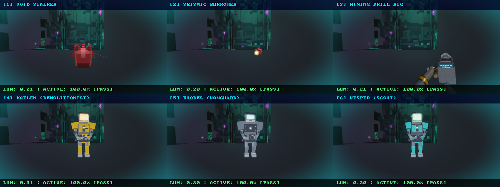
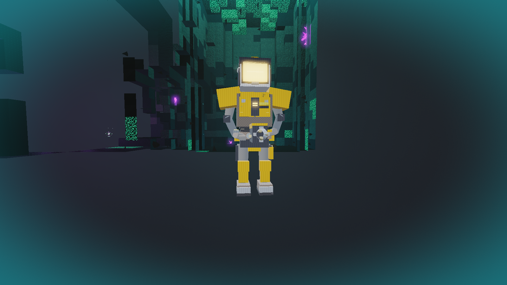
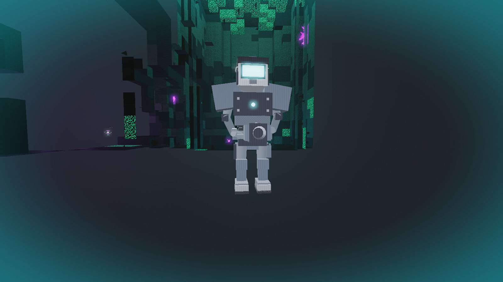
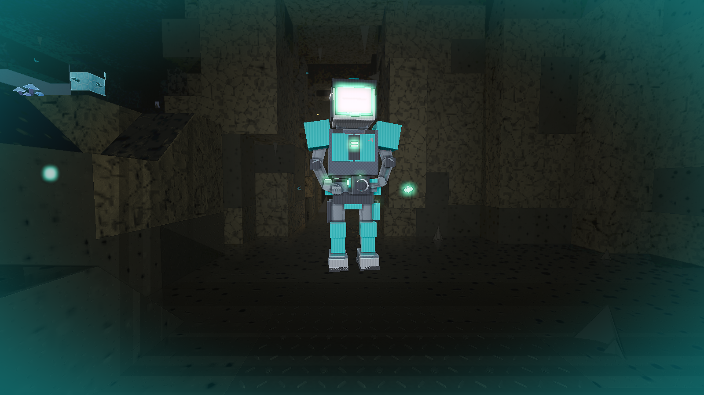

# Delver Contractors & Archetype Specifications

This document catalogs the 3 specialized subterranean contractor archetypes in **Voidfall Dredge**, including their 3D suit models, baseline performance attributes, unique traits, and equipment loadouts.

---

## Master Roster Visual Matrix



---

## 1. Demolitionist — Kaelen



- **Role**: Heavy Breacher // Volatile Mineral Specialist
- **Visual Model & Aesthetics**:
  - Charcoal ballistic pressure weave (`RGB(0.18, 0.20, 0.24)`).
  - Industrial hazard amber primary accents (`RGB(0.95, 0.55, 0.05)`).
  - Amber glowing blast visor (`RGB(1.0, 0.65, 0.10)`, Emissive 5.0).
  - Angled blast deflector pauldrons.
- **Specifications**:
  - **Base Health**: 100 HP (Non-regenerating suit integrity)
  - **Base Shield**: 50 SP (Recharging kinetic barrier layer)
  - **Excavation Speed**: 1.40x (Drill cuts soft and medium rock significantly faster)
  - **Movement Speed**: 1.00x
  - **Primary Combat Firearm**: **Magma Scattergun** (`[2]` or `[X]`)
    - *Capacity*: 6-round revolving drum (manual reload)
    - *Fire Mode*: 5-flechette thermite buckshot cone (37.5 max burst dmg, 38 m/s, amber tracer)
    - *Tactical Role*: Close-quarters predator breaker with heavy concussive knockback.
  - **Tactical Ability [C]**: **Concussion Shockwave** (18.0s recharge; omni-directional seismic disruption pulse that stuns nearby stalkers/burrowers and shatters loose ceiling rubble)
  - **Breaching Ordnance [4]**: **Deployable Satchel Charge & Remote Detonator** (plants physical C-4/voidite demolition block onto voxel faces; remote radio detonator triggers remote detonation to blast open Reinforced Vault Doors or blow giant tunnel cavities)
  - **Passive Trait**: *Surgical Blast & Volatile Refining* (+25% extra yield from Volatile Quartz clusters; directional demolition charges avoid collateral damage to fragile minerals).

---

## 2. Vanguard — Rhodes



- **Role**: Armored Stabilizer // Cave-in Defense Fortress
- **Visual Model & Aesthetics**:
  - Dark alloy armored suit plates with cyan tectonic accents (`RGB(0.20, 0.85, 1.00)`).
  - Heavy ballistic reinforced faceplate with narrow slit optics visor (`RGB(0.20, 0.90, 1.00)`, Emissive 5.0).
  - Double-layered fortress shoulder pauldrons and magnetic anchor boots.
- **Specifications**:
  - **Base Health**: 135 HP (Non-regenerating suit integrity)
  - **Base Shield**: 75 SP (Heavy reinforced kinetic barrier)
  - **Excavation Speed**: 1.00x
  - **Movement Speed**: 0.88x (Heavy armor trade-off)
  - **Max Placed Bulkheads**: 12 (Industry standard support brackets)
  - **Primary Combat Firearm**: **Plasma Carbine** (`[2]` or `[X]`)
    - *Capacity*: 16-round capacitor battery (manual reload required; zero passive trickle)
    - *Fire Mode*: Rapid-pulse coherent plasma bolt (22 dmg, 52 m/s, electric-cyan tracer)
    - *Tactical Role*: Sustained mid-range suppression against charging Stalkers and Burrowers.
  - **Tactical Ability**: Kinetic Repulsor Field (20.0s recharge; omni-directional pulse repelling enemies with knockback and stun, deflecting falling debris, and restoring 25 HP suit integrity)
  - **Passive Trait**: *Tectonic Bulkhead Plating* (50% passive damage reduction from falling roof collapse debris; placed industrial bulkheads deflect ceiling cave-in boulders).

---

## 3. Scout — Vesper



- **Role**: Acoustic Pathfinder // High-Mobility Reconnaissance
- **Visual Model & Aesthetics**:
  - Lightweight aerodynamic composite weave with emerald survey accents (`RGB(0.15, 1.00, 0.45)`).
  - Curved panoramic reconnaissance visor with high-luminance survey optics (`RGB(0.15, 1.00, 0.45)`, Emissive 5.0).
  - Twin vector thruster nozzles mounted on Exo-Pack; wrist-mounted sonar emitter and grapple winch spool.
- **Specifications**:
  - **Base Health**: 80 HP (High-mobility lightweight rig trade-off; non-regenerating)
  - **Base Shield**: 40 SP (Rapid recharging recon shield)
  - **Excavation Speed**: 1.00x
  - **Movement Speed**: 1.20x (+20% sprint/walk velocity)
  - **Grapple Pull Speed**: 1.50x
  - **Sonar Scan Sphere**: 22-meter radius (vs. 14m default)
  - **Primary Combat Firearm**: **Needler Railgun** (`[2]` or `[X]`)
    - *Capacity*: 8-round needle cartridge (manual reload)
    - *Fire Mode*: Hyper-velocity electromagnetic needle (42 dmg, 110 m/s, zero spread, emerald tracer)
    - *Tactical Role*: Long-distance cavern sniper; neutralizes ceiling ambush predators before they descend.
  - **Tactical Ability**: Seismic Sonar Overdrive (12.0s recharge; emits 360-degree sonic shockwave that stuns Stalkers for 3.0s and reveals all mineral veins through solid rock)
  - **Passive Trait**: *Acoustic Resonance & High-Tension Winch* (Extended scan outline linger, rapid grapple ascension to escape ambushes).

---

## 4. Two-Tier Delver Defense System: Shield Layer & Permanent Hitpoints

Subterranean survival in Voidfall Dredge utilizes a high-stakes **two-tier defense architecture**:
1. **Recharging Kinetic Shield Layer (`shield`, `max_shield`)**:
   - **Outer Protective Shell**: Absorbs all incoming damage sources first (predator claws, falling ceiling debris, kinetic gunshots, thermal lava, and spikes).
   - **Out-of-Combat Auto-Recharge**: After taking no damage for $4.0\,\text{s}$ (`shield_recharge_delay`), the suit's kinetic barrier automatically recharges at a rate of $+15.0\,\text{SP/s}$ (`shield_recharge_rate`) until reaching $100\%$ capacity.
   - **Combat Disruption**: Taking damage instantly resets the recharge timer to $0\,\text{s}$, stopping any ongoing recharge until the delver breaks line of sight or secures cover.
   - **HUD Telemetry**: Exhibited on the bottom-left Vitals gauge as `KINETIC SHIELD` with an electric-cyan bar and animated `[REGEN]` tag during recharge.
2. **Permanent Hitpoints / Suit Integrity (`health`, `max_health`)**:
   - **Non-Regenerating Core**: Once incoming damage exceeds current shield capacity, the remaining overflow directly reduces suit integrity hitpoints.
   - **Zero In-Combat or Passive Regeneration**: Once damaged, hitpoints cannot be regenerated by out-of-combat triage nanites. Every point of hull integrity lost during an expedition represents permanent wear and tear on the delver's rig.
   - **Lethality**: Reaching $0\,\text{HP}$ results in critical suit breach and immediate expedition failure. Dead delvers cannot recharge shields.

---

## 5. Defensive Quick Melee & Viewmodel Weapon Animations (`[V]` or `[Middle Click]`)

All delver classes possess a defensive close-quarters melee shove ($0.8\,\text{s}$ cooldown, $2.5\,\text{m}$ reach—expandable to $3.2\,\text{m}$ / $90^\circ$ cleave with `Cleave Shockwave`, $15\,\text{base HP}$ damage scaled by `Pneumatic Impact`, interrupt knockback, and $0.6\,\text{s}$ stalker stun). Each weapon archetype features a bespoke 4-phase kinetic first-person viewmodel animation and dedicated procedural audio synthesis:

| Weapon / Tool Held | Animation Style & Kinematics | Visual Feedback & FX | Procedural Audio Cue |
| :--- | :--- | :--- | :--- |
| **Magma Scattergun** (`Demolitionist`) | **Heavy Horizontal Butt-Stroke Cleave**<br>- Phase 1 ($0.0-0.22$): Heaves 15kg blunderbuss right & lifts stock ($X+0.08\,\text{m}$, $Z+0.12\,\text{m}$, yaw $+32^\circ$, roll $+24^\circ$)<br>- Phase 2 ($0.22-0.46$): Devastating $84^\circ$ horizontal roundhouse stock cleave sweeping across FOV ($X-0.24\,\text{m}$, $Z-0.28\,\text{m}$, yaw $-52^\circ$, roll $-38^\circ$)<br>- Phase 3 ($0.46-0.62$): $36\,\text{Hz}$ heavy inertial deceleration & weapon rattle<br>- Phase 4 ($0.62-1.0$): Fluid quadratic recovery back to hipfire pocket | Superheated magma heat vents flare bright amber ($+0.90$ emissive) at peak swing; heavy camera yaw trauma | `SoundCue::MeleeSwingScattergun`<br>Deep sub-bass air rush ($48 \rightarrow 24\,\text{Hz}$) + resonant steel stock thump & heavy air turbulence |
| **Needler Railgun** (`Scout`) | **Supersonic Bayonet Lance Thrust**<br>- Phase 1 ($0.0-0.18$): Dead-centerline coiling into chest ($Z+0.14\,\text{m}$, pitch $-4^\circ$, roll $-12^\circ$)<br>- Phase 2 ($0.18-0.38$): Quartic snap centerline spear impalement ($Z-0.38\,\text{m}$ deep forward reach) with $46^\circ$ dynamic helical rifling twist (roll $+34^\circ$)<br>- Phase 3 ($0.38-0.52$): $55\,\text{Hz}$ ultrasonic coil micro-vibration<br>- Phase 4 ($0.52-1.0$): Crisp marksman withdrawal snap | Induction coils hum during coil; blinding emerald rail discharge flare ($+0.95$ emissive) at peak extension; sharp centerline impulse | `SoundCue::MeleeSwingRailgun`<br>Supersonic air whip ($480 \rightarrow 95\,\text{Hz}$) + $1650\,\text{Hz}$ electromagnetic coil zing & aerodynamic pierce |
| **Plasma Carbine** (`Vanguard`) | **Tactical CQC Muzzle Uppercut**<br>- Phase 1 ($0.0-0.20$): Tactical coil & chamber drop ($Y-0.07\,\text{m}$, pitch $-22^\circ$ down-angle, $Z+0.08\,\text{m}$)<br>- Phase 2 ($0.20-0.44$): Brutal vertical chin-check muzzle smash ($Y+0.11\,\text{m}$ upward heave, pitch $+30^\circ$, $Z-0.28\,\text{m}$ forward punch)<br>- Phase 3 ($0.44-0.60$): $40\,\text{Hz}$ tactical recoil bounce & muzzle shudder<br>- Phase 4 ($0.60-1.0$): Fast military recovery snap to shoulder firing pocket | Cyan plasma capacitor vents flare with electric discharge ($+0.85$ emissive) on contact; upward vertical camera kick | `SoundCue::MeleeSwingCarbine`<br>Aerodynamic whip ($180 \rightarrow 60\,\text{Hz}$) + high-voltage capacitor ionization zap ($920 \rightarrow 360\,\text{Hz}$) |
| **Mining Drill Rig** (`MiningDrill`) | **Two-Handed Hydraulic Battering Ram**<br>- Phase 1 ($0.0-0.24$): Low hip-braced wind-up ($Z+0.11\,\text{m}$, $Y-0.06\,\text{m}$), pistons retract ($-0.04\,\text{m}$), auger motor RPM spools up ($+4200\,\text{deg/s}$)<br>- Phase 2 ($0.24-0.48$): Devastating hydraulic ram ($Z-0.30\,\text{m}$, $Y+0.075\,\text{m}$ uppercut heave), dual pistons slam forward to full extension ($+0.08\,\text{m}$), auger RPM peaks ($+6500\,\text{deg/s}$)<br>- Phase 3 ($0.48-0.68$): $42\,\text{Hz}$ heavy machinery shudder and pneumatic exhaust vent<br>- Phase 4 ($0.68-1.0$): Heavy mechanical settle back to waist hold | Superheated diamond auger emissive flare ($+0.75$ glow); pneumatic dual pistons visibly surge; directional impact friction sparks | `SoundCue::MeleeSwingDrill`<br>Pneumatic air displacement swoosh ($130 \rightarrow 45\,\text{Hz}$) + high-torque motor harmonic + 650Hz exhaust hiss |
| **Tactical Detonator** (`DemolitionCharge`) | **Gauntlet Clacker Power Punch**<br>- Phase 1 ($0.0-0.20$): Braced coil tight to chest like brass-knuckle fist ($Z+0.08\,\text{m}$, pitch $+16^\circ$)<br>- Phase 2 ($0.20-0.42$): Forward cross punch straight down crosshair ($Z-0.26\,\text{m}$, $X-0.12\,\text{m}$, roll $+22^\circ$)<br>- Phase 3 ($0.42-0.58$): Elastic rebound ($+0.055\,\text{m}$) and settling shake<br>- Phase 4 ($0.58-1.0$): Settle back to handheld inspection stance | Tactile detonator plunger depresses inward under force ($-0.022\,\text{m}$); safety beacon flares with high-intensity shock flash ($+0.70$ glow) | `SoundCue::MeleeSwingDetonator`<br>Solid fist punch whoosh ($95 \rightarrow 40\,\text{Hz}$) + military clacker spring latch click + exo-servo hiss |
| **Connected Melee Strike** (Any Weapon) | **Visceral Chitin & Flesh Impact** | HUD hit-marker triggered; Berserker Overdrive siphons $+12$ shield/tier and triggers $+15\%$ speed boost | `SoundCue::MeleeHitFlesh`<br>Concussive sub-bass body thump ($55 \rightarrow 35\,\text{Hz}$) + bone-cracking chitin snap ($2200\,\text{Hz}$) + wet alien flesh squelch |

---

## Model Reference Generation

All character and enemy reference captures are maintained in [`docs/models/`](file:///d:/Projects/voxel_3d_voidfall_dredge/docs/models/) and regenerated automatically via:

```bash
python scripts/capture_models.py
```
